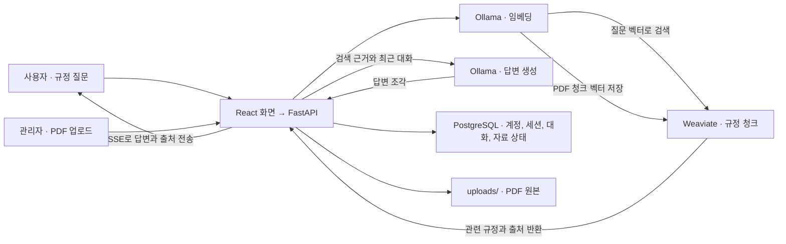

# TempRag · 학교 규정 GPT

학교 규정 PDF에서 질문과 관련된 내용을 찾아 답변을 작성하는 RAG 챗봇입니다. 사용자는 답변과 함께 근거 문서와 페이지를 확인할 수 있고, 관리자는 검색에 사용할 PDF를 관리합니다.

## 서비스 흐름

| 사용자 · 규정 질문 | 관리자 · 규정 자료 등록 |
| --- | --- |
| 1. 로그인하고 새 채팅 또는 기존 대화를 엽니다. | 1. 관리자 계정으로 로그인하고 **자료 관리**에서 PDF를 선택합니다. |
| 2. 질문을 보내면 FastAPI가 Ollama로 질문의 임베딩을 만듭니다. | 2. FastAPI가 PDF의 페이지별 텍스트를 청크로 나누고 Ollama로 임베딩합니다. |
| 3. Weaviate에서 질문과 가까운 규정 청크를 찾습니다. | 3. Weaviate에 청크 벡터와 문서 ID, 페이지를 저장합니다. |
| 4. 검색된 규정과 최근 대화를 바탕으로 Ollama가 답변을 생성합니다. | 4. 등록된 PDF는 질문에 답할 때 검색 대상으로 사용됩니다. |
| 5. 화면에 출처와 답변이 표시되고, 대화 기록은 PostgreSQL에 저장됩니다. | 5. 자료 관리에서 등록 상태를 확인하거나 PDF를 삭제할 수 있습니다. |

관련 규정을 찾지 못하면 검색 결과가 없다는 안내를 표시합니다. 텍스트가 없는 스캔 PDF는 OCR을 적용한 뒤 업로드합니다.

## 시작하기

Docker Compose는 기존 PostgreSQL, Weaviate, Ollama 컨테이너를 사용해 웹 앱을 실행합니다. [실행 명령과 환경 변수](rag-project/README.md#실행하기)를 확인하세요.

| 경로 | 역할 |
| --- | --- |
| [frontend/](rag-project/frontend/) | React 로그인, 채팅, 자료 관리 화면 및 SSE 처리 |
| [backend/app/](rag-project/backend/app/) | FastAPI 인증, 대화 저장, PDF 색인 및 RAG 처리 |
| [compose.yaml](rag-project/compose.yaml) | 기존 서비스에 연결되는 앱 컨테이너 설정 |
